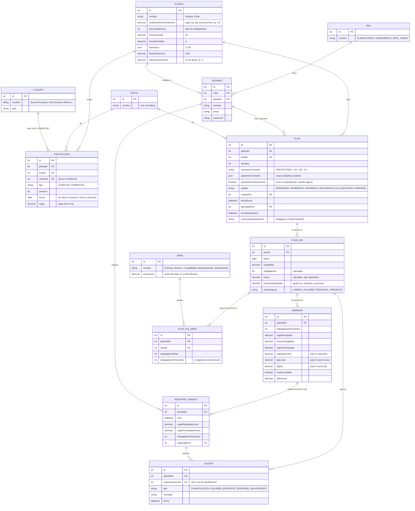

# Plan de Packing · Contexto del sistema

Resumen del estado actual del diseño (10/10/2026). Refleja el artefacto **Flujos Plan de Packing** en Claude Design: https://claude.ai/artifact/AZVy84DGpaZidzHRiivV7q

- Stack objetivo: **Next.js** (frontend) + **NestJS** (backend).
- Empresa: Pura Fruit. Plantas: **Piura (Santa María)** y **Sullana**.
- Frutas: uva y arándano. Las variedades se agregarán después.

---

## 1. Problema que resuelve

Cosecha proyecta cuánta fruta llega y comercial proyecta cuánto vende, pero hoy no hay un plan que cruce ambas cosas con la capacidad de la planta. El resultado es improvisación en personal y horas, días que se alargan y riesgo de un segundo turno.

El sistema:

1. Recibe la **proyección de cosecha**, por semana y por día.
2. Recibe el **programa comercial** de la semana, por cliente.
3. Calcula un **plan semanal por planta**: meta diaria, trabajadores y horas.
4. Lo pasa por **aprobación** del subgerente.
5. Durante cada jornada registra **avances**, compara el volumen entrante contra el plan, lanza **alertas** y ajusta **horas**.
6. Al cierre registra horas reales, meta cumplida y diferencia.

---

## 2. Reglas de negocio confirmadas

| Tema | Regla |
|---|---|
| Unidad | Caja de **8.2 kg**, tanto para cosecha como para comercial. Si llega en toneladas, la app convierte a cajas; no hay tabla de unidades. |
| Alcance del plan | Un plan por **planta** y por semana. Sin líneas en el MVP. |
| Turnos | **Un solo turno**. Un turno extra es lo que se quiere evitar. |
| Personal | Se cuenta **todo el personal** (packing, almacén, trazabilidad, mantenimiento, saneamiento). No se usan posiciones de línea ni la relación directo-indirecto. |
| Trabajadores | **Los calcula el sistema**; el planificador no los ingresa. |
| Parámetros | Viven en la **configuración de la planta**. El planificador puede **sobrescribirlos solo para un plan** (opcional, en un panel desplegable). |
| Proyecciones | Son **inmutables** una vez registradas. |
| Aprobación | Solo se aprueba el **plan semanal**. En la ejecución diaria solo se **ajustan horas** (por volumen o por personal presente), nunca la meta. |
| Fruta pendiente | Normalmente no pasa al día siguiente; se extienden horas. En casos muy excepcionales sí pasa: queda fuera del MVP, pero el diseño no debe asumir que nunca ocurre. |
| Alertas | Al inicio, solo la alerta de **planificación** (cosecha vs comercial). Durante la jornada, alertas de **volumen entrante vs plan** en cada registro de avance. El packing empieza alrededor de las 5 PM. |
| Avances | Los **registros de avance** durante la jornada y las **horas actualizadas** entran en el MVP. |
| Pendiente | La brecha por cliente (qué clientes no se cubren y en qué %) se iterará después. |

### Roles

| Rol | Qué hace |
|---|---|
| **Planificador** | Simula, aplica el plan oficial y lo envía a aprobación. |
| **Subgerente** | Revisa y aprueba o rechaza los planes, sigue el curso de la semana y edita la configuración de planta. |
| **Jefe de turno** | Ve el plan aprobado, registra avances, ajusta horas y cierra la jornada. |

---

## 3. Parámetros de planta (pantalla Configuración)

| Parámetro | Piura | Sullana | Para qué sirve |
|---|---|---|---|
| Rendimiento estándar por persona | 5.0 cajas eq./h | 5.9 cajas eq./h | Cajas que procesa en promedio una persona en una hora, contando a todo el personal. |
| Personal máximo disponible | 300 | 1,200 | Tope de trabajadores. Si se necesitan más, el plan sube las horas. |
| Horas por jornada | 10 h | 12 h | Duración normal del turno. |
| Horas extra permitidas | 2 h | 2 h | Máximo que se puede extender el turno el mismo día. |
| Hora de inicio | 17:00 | 17:00 | Sirve para estimar la hora de fin. |
| Eficiencia planificada | 80% | 80% | El plan asume ese porcentaje del rendimiento; lo que sobra es margen para imprevistos. |
| Tolerancia de volumen entrante | 5% | 5% | Desvío de jabas frente a lo esperado que no genera alerta. |

> Los rendimientos se **infirieron** de los reportes de la semana 41 (cajas eq. ÷ personal total ÷ horas) y el personal máximo es un valor de ejemplo. Hay que reemplazarlos por los valores oficiales.
> Las cajas equivalentes por jaba (≈0.86 en Piura, ≈0.95 en Sullana) **no son un parámetro del sistema**: la cosecha se carga ya en cajas. En las pantallas solo se usan para mostrar el ejemplo en jabas.

---

## 4. Cálculos

**Trabajadores por día**

```
trabajadores = ceil( cajasMeta / (rendimiento × eficiencia × horasJornada) )
trabajadores = min(trabajadores, personalMaximo)
```

**Horas por día**

```
horas = cajasMeta / (trabajadores × rendimiento × eficiencia)
```

**Margen para volumen extra**: cuánta fruta adicional entra en la jornada más las horas extra.

```
margen = trabajadores × rendimiento × eficiencia × (horasJornada + horasExtra) / cajasMeta − 1
```

**Estado de cada día**

| Condición | Estado |
|---|---|
| horas ≤ jornada | Dentro de jornada |
| horas > jornada | Requiere horas extra |
| horas > jornada + horas extra | Riesgo de turno extra |
| margen < tolerancia | Margen bajo |

**Alerta de planificación**: aparece si la cosecha en cajas es menor que el programa comercial. Muestra la brecha en cajas y en %.

**Reparto por área**: el total de trabajadores se divide con la proporción observada en la semana 41.

| Área | Proporción |
|---|---|
| Almacén | 3.9% |
| Trazabilidad | 2.5% |
| Mantenimiento | 2.1% |
| Saneamiento | 4.5% |
| Packing | El resto |

**Ejemplo (Piura)**

- Día normal: 13,000 jabas ≈ 11,180 cajas eq. 11,180 / (5.0 × 0.8 × 10) = **280 trabajadores** durante unas **10 h**, con un margen de **+20%**.
- Escenario +20% de cosecha: el cálculo pide 336 trabajadores, pero el tope es 300. Con el tope, el día dura 11.2 h y queda en "Requiere horas extra".

**En la jornada (jefe de turno)**

- Las horas estimadas se calculan con el ritmo real, que depende de los trabajadores presentes.
- Ejemplo: 186 presentes de 284 planificados da unas 12.0 h, contra 9.8 h del plan.
- Si las horas estimadas caben en el plan, no se cambian horas. Si el volumen se desvía más que la tolerancia, sale una alerta informativa.
- Si las horas no caben, se proponen **horas actualizadas** con un motivo (CAMBIO_VOLUMEN o PERSONAL_PRESENTE).

---

## 5. Pantallas (artefacto Flujos Plan de Packing)

Todas usan un menú superior común: Dashboard · Planificador · Subgerente · Jefe de turno · Configuración.

### Planificador · Plan semanal (semana 42, Piura)

1. Ve la proyección de cosecha (jabas y cajas eq. por día) y el programa comercial por cliente. Ambas se cargan por Excel y son de solo lectura. Si la cosecha no cubre el programa, aparece la alerta de planificación (en el ejemplo faltan 2,400 cajas, el 4.4%).
2. **Paso 1 · Simulación** (borrador, no se guarda):
   - Muestra los parámetros de la planta como etiquetas, con un enlace a Configuración.
   - Tiene un panel desplegable **"Sobrescribir parámetros para esta simulación"** (opcional). Los campos vacíos usan el valor de la planta; los sobrescritos se marcan en naranja.
   - Escenarios de cosecha: proyectada, +10%, +20% y −10%.
   - KPIs: meta de la semana, trabajadores calculados (pico y promedio), horas de operación y cumplimiento comercial.
   - Tabla por día: jabas, cajas eq., trabajadores, horas, margen y estado.
3. **"Aplicar como plan oficial"** guarda la simulación como **Paso 2 · Plan oficial**, que incluye el personal por área.
4. **"Enviar a aprobación"** solo se habilita cuando ya existe un plan oficial.

### Subgerente · Planes

- **Lista de planes** de todas las plantas, con filtros por estado y su conteo: Por aprobar, En ejecución, Aprobados, Rechazados y Cerrados. La pestaña muestra un contador rojo con los planes pendientes.
- Cada fila muestra planta, semana, fechas, meta, trabajadores pico, horas y estado. La acción depende del estado:
  - Por aprobar: "Revisar y aprobar".
  - En ejecución: "Ver curso".
  - Otros: "Ver detalle".
- **Detalle del plan** (con "Volver a planes"):
  - Muestra la alerta comercial, los KPIs, los parámetros usados (indicando si alguno fue sobrescrito) y el plan diario con el personal por área.
  - Si está pendiente, se puede **aprobar** o **rechazar y devolver**; el comentario es obligatorio para rechazar. Si no está pendiente, se muestra qué pasó con el plan.
- Datos de ejemplo:
  - Semana 42 de Piura y de Sullana, por aprobar.
  - Semana 41 de ambas plantas, en ejecución.
  - Semana 40 de ambas plantas, cerrada.

### Subgerente · Curso de la semana

- Muestra el reporte de Piura de la semana 41, proyectado vs ejecutado, con los mismos datos del reporte real:
  - Jabas, cumplimiento y cajas eq.
  - % loose y % fijo.
  - Rendimiento /JH y /HR.
  - % descarte.
  - Personal proyectado y ejecutado por área.
  - Ausentismo y horas.
  - Ocupabilidad y posiciones.
- Incluye la "Lectura de la semana" con hallazgos y un aviso de planes pendientes que lleva a la lista.
- Por ahora solo hay datos reales de Piura.

### Jefe de turno · Jornada en curso (Piura, viernes)

- Muestra la meta del día (13,000 jabas ≈ 11,180 cajas eq.), los trabajadores presentes frente a los planificados y las horas estimadas al ritmo real, frente a las del plan.
- Escenarios de ejemplo: según plan, +10% de jabas, +30% de jabas y "Real de hoy: 186 trabajadores".
- Si las horas no alcanzan, muestra una alerta y la opción de **ajustar horas** con motivo.
- Incluye el personal por área (proyectado vs presente), la barra de avance, el formulario **Registrar avance** (hora, jabas recibidas, cajas procesadas y trabajadores presentes) y **Cerrar jornada** (horas reales, jabas, meta cumplida y diferencia).

### Dashboard de packing

- Tiene un filtro por planta (Piura o Sullana) con datos reales de la semana 41.
- 6 KPIs con semáforo:
  - Cumplimiento de jabas.
  - Horas promedio.
  - Ocupabilidad.
  - Personal ejecutado vs proyectado.
  - Rendimiento.
  - Descarte.
- 3 puntos de atención calculados.
- 6 gráficos por día:
  - Jabas proyectadas vs ejecutadas.
  - Horas, con una línea de referencia de 12 h.
  - Ocupabilidad.
  - Personal.
  - Rendimiento.
  - % descarte.
- Al pasar el cursor se ve el detalle de cada barra.

### Configuración de planta

- Tiene pestañas Piura y Sullana con tres bloques: Personal y rendimiento, Jornada, y Eficiencia y tolerancias.
- Un panel muestra **"Así calcula el sistema"** en vivo: cajas por persona por jornada, trabajadores necesarios, horas y margen. También avisa si el personal necesario supera el máximo.
- Botones Guardar y Descartar, con un indicador de cambios sin guardar. Los cambios afectan solo a planes nuevos; los planes ya aplicados guardan los valores con que se crearon.

### Flujos

- **Flujo 1 · Planificación semanal**: cosecha y comercial, luego simulación, plan oficial y aprobación.
- **Flujo 2 · Ejecución diaria**: inicio, avances, alertas, ajuste de horas y cierre.

---

## 6. Modelo de datos esencial

Detalle completo en [uml-bd-esencial.md](uml-bd-esencial.md). La referencia ampliada es [uml-bd-v4.md](uml-bd-v4.md).

```
ROL ─< USUARIO >─ PLANTA
PLANTA ─< PROYECCION >─ FRUTA        (tipo COSECHA o COMERCIAL)
           PROYECCION >─ CLIENTE      (solo en COMERCIAL)
PLANTA ─< PLAN >─ FRUTA
          PLAN ─< PLAN_DIA ─┬─o JORNADA ─< REGISTRO_AVANCE ─< ALERTA
                            ├─< ALERTA (de planificacion)
                            └─< PLAN_DIA_AREA >─ AREA
```

### UML de datos (diagrama entidad-relación)



### Resumen por entidad

| Entidad | Campos clave |
|---|---|
| ROL | nombre: PLANIFICADOR, SUBGERENTE o JEFE_TURNO |
| USUARIO | rolId, plantaId, nombre, email |
| PLANTA | rendimientoPersonaHora, personalMaximo, horasJornada, horasExtraMax, horaInicio, factorEficiencia, toleranciaVolumen |
| FRUTA | nombre: Uva o Arándano |
| AREA | nombre (Packing, Almacén, Trazabilidad, Mantenimiento, Saneamiento), proporción |
| CLIENTE | nombre, país |
| PROYECCION | plantaId, frutaId, clienteId (solo en COMERCIAL), tipo (COSECHA o COMERCIAL), semana, fecha (por día en cosecha), cajas |
| PLAN | plantaId, frutaId, semana, escenarioCosecha, parametrosUsados (copia completa), parametrosSobrescritos (sí/no), estado, creadoPor, fechaEnvio, aprobadoPor, fechaAprobacion, comentarioAprobacion |
| PLAN_DIA | planId, fecha, cajasMeta, trabajadores (calculado), horas (calculado), horasActualizadas, motivoAjuste |
| PLAN_DIA_AREA | planDiaId, areaId, trabajadoresPlan, trabajadoresPresentes |
| JORNADA | planDiaId, trabajadoresPresentes, cajasRecibidas, horasTrabajadas, cajasProcesadas, cajasDescarte, kgLoose, kgFijo, metaCumplida, diferencia |
| REGISTRO_AVANCE | jornadaId, hora, cajasRecibidasAcum, cajasProcesadasAcum, trabajadoresPresentes, registradoPor |
| ALERTA | planDiaId, registroAvanceId (null si es de planificación), tipo (PLANIFICACION, VOLUMEN_ENTRANTE o PERSONAL_INSUFICIENTE), mensaje, fecha |

**Estados de PLAN**: BORRADOR (oficial, sin enviar), luego PENDIENTE (enviado a aprobación). Desde ahí pasa a APROBADO, luego EN_EJECUCION y finalmente CERRADO; o a RECHAZADO, que vuelve al planificador.

> La simulación **no se guarda** en la BD: es estado de la pantalla hasta que se aplica como plan oficial.

**Métricas calculadas (no se guardan):** rendimiento = cajasProcesadas ÷ trabajadoresPresentes ÷ horasTrabajadas; ausentismo = presentes vs plan por área; % descarte = cajasDescarte ÷ cajasProcesadas; % loose/fijo = kgLoose o kgFijo ÷ (kgLoose + kgFijo); cumplimiento = procesadas ÷ meta. La cosecha se carga ya en cajas (la conversión desde jabas se hace antes de cargar). Posiciones de línea, ocupabilidad y relación directo-indirecto no se modelan.

### Descripción de cada tabla (back y front)

Convenciones generales:
- Todas las tablas llevan `createdAt` y `updatedAt`. Los montos de fruta van en **cajas de 8.2 kg** y las horas en decimal (por ejemplo, 9.5 = 9 h 30 min).
- Los enums se guardan como texto en mayúsculas.
- Back: NestJS con un módulo por agregado (auth, plantas, proyecciones, planes, jornadas, alertas). Los cálculos viven en un servicio del back (`PlanCalculatorService`), nunca solo en el front.
- Front: Next.js. Las pantallas de referencia están en el artefacto Flujos Plan de Packing.

#### ROL
- **Qué es:** el catálogo de roles: `PLANIFICADOR`, `SUBGERENTE` y `JEFE_TURNO`.
- **Back:**
  - Se crea por seed y no se edita desde la app.
  - Se usa en un guard de permisos:

    | Acción | Rol que puede hacerla |
    |---|---|
    | Crear, aplicar y enviar planes | Planificador |
    | Aprobar o rechazar planes, y editar la configuración de planta | Subgerente |
    | Registrar avances, ajustar horas y cerrar la jornada | Jefe de turno |
    | Ver el dashboard | Todos |
- **Front:** según el rol del usuario, decide qué opciones del menú se muestran y qué botones se habilitan.

#### USUARIO
- **Qué es:** una persona que entra al sistema.
- **Back:**
  - `email` es único y `password` se guarda con hash (bcrypt).
  - El login devuelve un JWT con `userId`, `rol` y `plantaId`.
  - `plantaId` limita lo que ve el planificador y el jefe de turno. Si el subgerente tiene `plantaId` null, ve todas las plantas.
- **Front:** pantalla de login, y nombre y rol en la cabecera. El selector de planta solo aparece si el usuario ve más de una planta.

#### PLANTA
- **Qué es:** cada planta (Piura, Sullana) con sus parámetros estándar de cálculo.
- **Back:**
  - Solo el subgerente puede editarla.
  - Validaciones:
    - `rendimientoPersonaHora` > 0.
    - `personalMaximo` ≥ 1.
    - `horasJornada` entre 1 y 24.
    - `horasExtraMax` ≥ 0.
    - `factorEficiencia` entre 0.1 y 1 (en pantalla se muestra en %).
    - `toleranciaVolumen` entre 0 y 100.
  - Un cambio **no** modifica planes existentes, porque cada PLAN guarda su copia en `parametrosUsados`.
  - Endpoints: `GET /plantas/:id` y `PATCH /plantas/:id`.
- **Front:** pantalla **Configuración de planta**, con una pestaña por planta, Guardar y Descartar, y el panel de vista previa "Así calcula el sistema", que se calcula en el cliente con la misma fórmula. La simulación del planificador muestra estos valores como etiquetas.

#### FRUTA
- **Qué es:** el catálogo de frutas (Uva, Arándano). Las variedades irán más adelante.
- **Back:** se crea por seed.
- **Front:** selector de fruta al cargar proyecciones y al crear un plan.

#### CLIENTE
- **Qué es:** los clientes del programa comercial (FGA, Summit Produce, etc.).
- **Back:** CRUD simple. Si en la carga del Excel comercial aparece un cliente nuevo, se crea.
- **Front:** columna "Cliente" de la tabla del programa comercial en la pantalla del planificador.

#### AREA
- **Qué es:** las áreas de personal (Packing, Almacén, Trazabilidad, Mantenimiento, Saneamiento) y su `proporcion` del total.
- **Back:**
  - Se crea por seed con las proporciones de la semana 41:

    | Área | Proporción |
    |---|---|
    | Almacén | 0.039 |
    | Trazabilidad | 0.025 |
    | Mantenimiento | 0.021 |
    | Saneamiento | 0.045 |
    | Packing | El resto |

  - Al calcular un PLAN_DIA, se reparte el total: las áreas de apoyo reciben `round(total × proporcion)` y Packing se queda con la diferencia, para que la suma cuadre exacto.
- **Front:** columnas por área en el plan oficial, en el detalle del plan del subgerente y en la tabla de personal del jefe de turno.

#### PROYECCION
- **Qué es:** lo que cosecha prevé que llega (por día) y lo que comercial prevé vender (por semana y cliente), siempre en cajas.
- **Back:**
  - Si `tipo = COSECHA`: `fecha` es obligatoria y `clienteId` va null.
  - Si `tipo = COMERCIAL`: `clienteId` es obligatorio y `fecha` va null.
  - Es **inmutable**: no hay update. Si hay un error, se carga una versión nueva y se marca la anterior como reemplazada (fuera del MVP; en el MVP solo se crea).
  - Carga por Excel: `POST /proyecciones/import` con `tipo`, `plantaId`, `frutaId`, `semana` y el archivo.
  - Si llega en toneladas, se convierte a cajas (kg ÷ 8.2) antes de guardar.
  - Índice: (`plantaId`, `frutaId`, `semana`, `tipo`).
- **Front:**
  - Tablas "Proyección de cosecha" y "Programa comercial" en la pantalla del planificador, con el botón "Importar Excel" y sin edición.
  - Si la cosecha de la semana es menor que el total comercial, muestra la **alerta de planificación** con la brecha en cajas y en %.

#### PLAN
- **Qué es:** el plan semanal oficial de una planta y una fruta. La simulación **no** es un PLAN: vive solo en el front hasta que se aplica.
- **Back:**
  - `POST /planes` (aplicar): recibe `plantaId`, `frutaId`, `semana`, `escenarioCosecha` y los parámetros sobrescritos, si los hay.
  - El back hace todo el cálculo:
    1. Arma `parametrosUsados` mezclando los valores de PLANTA con los sobrescritos.
    2. Marca `parametrosSobrescritos`.
    3. Crea los PLAN_DIA y sus PLAN_DIA_AREA.
    4. Si ya existe un plan BORRADOR para esa planta, fruta y semana, lo reemplaza.
  - Si la cosecha no cubre el programa comercial, crea una ALERTA de tipo `PLANIFICACION`.
  - Transiciones de estado (cualquier otra devuelve 409):

    | De | A | Quién | Acción |
    |---|---|---|---|
    | BORRADOR | PENDIENTE | Planificador | `POST /planes/:id/enviar`; guarda `fechaEnvio` |
    | PENDIENTE | APROBADO | Subgerente | `POST /planes/:id/aprobar`; guarda `aprobadoPor` y `fechaAprobacion` |
    | PENDIENTE | RECHAZADO | Subgerente | `POST /planes/:id/rechazar`; `comentarioAprobacion` es obligatorio |
    | RECHAZADO | BORRADOR | Planificador | Vuelve a aplicar el plan |
    | APROBADO | EN_EJECUCION | Sistema | Automático al abrirse la primera JORNADA de la semana |
    | EN_EJECUCION | CERRADO | Sistema | Automático al cerrar la última JORNADA |

  - Solo puede haber un plan APROBADO o EN_EJECUCION por planta, fruta y semana.
  - `GET /planes?estado=&plantaId=`: lista con los totales calculados (meta, trabajadores pico y horas).
- **Front:**
  - Planificador: paso 2 "Plan oficial" y botón "Enviar a aprobación".
  - Subgerente: lista **Planes**, con filtros por estado y contador de pendientes, y **detalle** con KPIs, parámetros usados, plan diario y bloque de aprobar o rechazar.
  - Para mostrar los estados:

    | Estado | Texto en pantalla | Color |
    |---|---|---|
    | PENDIENTE | Pendiente de aprobación | Ámbar |
    | EN_EJECUCION | En ejecución | Oscuro |
    | APROBADO | Aprobado | Verde |
    | RECHAZADO | Rechazado | Coral |
    | CERRADO | Cerrado | Gris |

#### PLAN_DIA
- **Qué es:** la meta de cada día del plan, con los trabajadores y horas calculados.
- **Back:**
  - Fórmulas, con los valores de `PLAN.parametrosUsados`:
    - `trabajadores = min(ceil(cajasMeta / (rend × efic × jornada)), personalMaximo)`.
    - `horas = cajasMeta / (trabajadores × rend × efic)`.
  - `cajasMeta` y `trabajadores` quedan **fijos** cuando el plan se aprueba.
  - Durante la ejecución solo cambian `horasActualizadas` y `motivoAjuste` (`CAMBIO_VOLUMEN` o `PERSONAL_PRESENTE`), con `PATCH /plan-dias/:id/ajuste-horas` y solo el jefe de turno.
  - Derivados para la respuesta (no se guardan):
    - `margen = trabajadores × rend × efic × (jornada + extra) / cajasMeta − 1`.
    - `estadoDia`:

      | Condición | estadoDia |
      |---|---|
      | horas ≤ jornada | DENTRO_JORNADA |
      | horas > jornada | HORAS_EXTRA |
      | horas > jornada + extra | RIESGO_TURNO_EXTRA |
      | margen < tolerancia | MARGEN_BAJO |
- **Front:** filas de la tabla diaria (simulación, plan oficial y detalle del subgerente) y cabecera del jefe de turno (meta del día y horas del plan). Etiquetas de estado:

  | estadoDia | Texto en pantalla | Color |
  |---|---|---|
  | DENTRO_JORNADA | Dentro de jornada | Verde |
  | HORAS_EXTRA | Requiere horas extra | Ámbar |
  | RIESGO_TURNO_EXTRA | Riesgo de turno extra | Coral |
  | MARGEN_BAJO | Margen bajo | Ámbar |

#### PLAN_DIA_AREA
- **Qué es:** los trabajadores planificados y presentes por área para un día.
- **Back:**
  - `trabajadoresPlan` se crea junto con el PLAN_DIA, repartiendo con `AREA.proporcion`.
  - `trabajadoresPresentes` lo actualiza el jefe de turno al abrir la jornada o en un avance.
  - La suma de presentes alimenta `JORNADA.trabajadoresPresentes`.
  - Única por (`planDiaId`, `areaId`).
- **Front:** tabla "Personal por área" del jefe de turno (proyectado, presente y diferencia en rojo si falta) y columnas por área en el plan. En el dashboard, el ausentismo = 1 − presentes ÷ plan.

#### JORNADA
- **Qué es:** la ejecución real de un PLAN_DIA. Se abre al iniciar el turno y se cierra al terminar.
- **Back:**
  - `POST /jornadas` (abrir, con los presentes por área).
  - `POST /jornadas/:id/cerrar`: recibe `horasTrabajadas`, `cajasProcesadas`, `cajasDescarte`, `kgLoose` y `kgFijo`. Calcula `metaCumplida = cajasProcesadas ≥ cajasMeta` y `diferencia = cajasProcesadas − cajasMeta`.
  - Hay una jornada por PLAN_DIA.
  - Abrir la primera jornada de la semana pasa el PLAN a EN_EJECUCION; cerrar la última lo pasa a CERRADO.
  - Si queda fruta sin procesar, el caso excepcional queda fuera del MVP, pero `diferencia` negativa lo deja registrado.
- **Front:**
  - Pantalla **Jefe de turno**: KPIs de recibido, procesado, trabajadores presentes y horas estimadas, y el formulario **Cerrar jornada**.
  - **Curso de la semana** y **Dashboard**, que muestran:
    - Ejecutado vs proyectado.
    - Horas.
    - % descarte = cajasDescarte ÷ cajasProcesadas.
    - % loose = kgLoose ÷ (kgLoose + kgFijo).
    - Rendimiento = cajasProcesadas ÷ presentes ÷ horas.

#### REGISTRO_AVANCE
- **Qué es:** una foto del avance durante la jornada, con valores acumulados.
- **Back:**
  - `POST /jornadas/:id/avances`.
  - Validaciones: los acumulados no pueden bajar respecto al avance anterior, y `hora` debe ser posterior al anterior.
  - Al guardar, se recalcula:
    - `ritmo = cajasProcesadasAcum ÷ horas transcurridas`.
    - `horasEstimadas = cajasMeta ÷ ritmo`, o con el volumen proyectado del día si llega más fruta.
    - `esperado = cajasMeta × horas transcurridas ÷ horas del plan`.
    - `desvío = (recibidas − esperado) ÷ esperado`.
  - Reglas de alertas:

    | Condición | Alerta | Qué más hace |
    |---|---|---|
    | desvío > `toleranciaVolumen` | `VOLUMEN_ENTRANTE` | — |
    | `horasEstimadas` > horas del plan por menos presentes | `PERSONAL_INSUFICIENTE` | Propone horas actualizadas |
    | `horasEstimadas` > jornada + extra | La alerta que corresponda | Marca riesgo de turno extra |
- **Front:**
  - Formulario **Registrar avance**: hora, jabas o cajas recibidas, cajas procesadas y trabajadores presentes.
  - Barras de avance contra la meta y lista de avances del día.
  - Muestra la alerta y el botón "Ajustar horas" cuando aplica.

#### ALERTA
- **Qué es:** un aviso generado por el sistema, nunca a mano.
- **Back:** tipos:

  | Tipo | Cuándo se crea | Ligada a |
  |---|---|---|
  | `PLANIFICACION` | Al aplicar el plan, si la cosecha no cubre lo comercial | Primer PLAN_DIA o plan completo; `registroAvanceId` null |
  | `VOLUMEN_ENTRANTE` | En un avance, si el desvío supera la tolerancia | Ese REGISTRO_AVANCE |
  | `PERSONAL_INSUFICIENTE` | En un avance, si faltan trabajadores para cumplir las horas | Ese REGISTRO_AVANCE |

  - `mensaje` guarda el texto listo para mostrar, con los números.
  - `GET /alertas?plantaId=&fecha=`.
- **Front:**
  - Banner coral en la pantalla del planificador (planificación) y en la del jefe de turno (volumen y personal).
  - Contador en el dashboard.
  - Siempre con ícono y texto, nunca solo color.

---

## 7. Marca y estilo de las pantallas

| Elemento | Valor |
|---|---|
| Verde | #2E9E4A (#1E7F38 en textos y botones) |
| Coral | #E2483C (#C2382C en textos); reservado para alertas |
| Oscuro | #1F1F1F |
| Fondo | #F3F4F2 |
| Tarjetas | Blancas y redondeadas, con títulos de sección en forma de píldora |
| Tipografía | Baloo 2 para títulos y Nunito para el texto |
| Logo | Marca "p" con el texto "purafruit" en #3DBE5C |
| Gráficos | Proyectado en ámbar #E8A23A y ejecutado en verde #1E7F38 (paleta validada para daltonismo) |

---

## 8. Pendientes y supuestos por confirmar

- **Valores oficiales**: confirmar el rendimiento estándar por persona-hora y el personal máximo de cada planta.
- **Brecha comercial por cliente**: qué clientes no se cubren y en qué %. Necesitará una entidad tipo PRODUCCION_CLIENTE.
- **Fruta que pasa al día siguiente**: los casos excepcionales quedan fuera del MVP.
- **Historial**: el historial de aprobaciones y de ajustes de horas queda fuera del MVP; hoy son campos en PLAN y PLAN_DIA.
- **Datos de Sullana**: "Curso de la semana" solo tiene datos reales de Piura.
- **Audio del reto**: no se pudo transcribir en el entorno en la nube, así que su contexto no está incluido.
